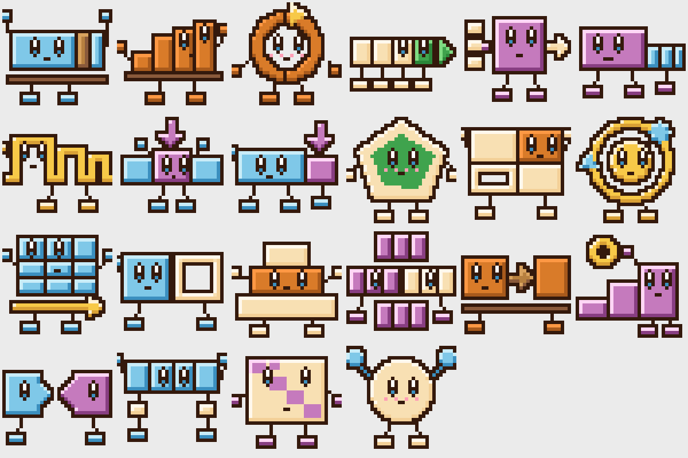

# 개념 도식(비인간) 캐릭터 디자인

책 속 **개념 노드**에서 나오는 캐릭터의 디자인 기준과 구현 방법을 정리한 문서임. 소설 등장인물(인물 노드)은 인간형 SD 캐릭터를 쓰며 이 문서 대상이 아님.

- 상위 규격: [`pixel-character-spec.md`](pixel-character-spec.md) §8(개념 도식), §10(인간형, 공통 기준), §11(아틀라스)
- 생성기: [`src/components/pixel/diagramCharacter.ts`](../src/components/pixel/diagramCharacter.ts)
- 캐릭터 정의: [`src/components/pixel/conceptCharacters.ts`](../src/components/pixel/conceptCharacters.ts)
- 등록·바둥 프레임·색 변형: [`src/components/pixel/sprites.ts`](../src/components/pixel/sprites.ts)



## 1. 핵심 원칙: 몸통 = 개념의 도식

캐릭터의 몸통은 그 개념을 설명할 때 교재·강의에서 실제로 그리는 그림(간트 차트, 막대그래프, 큐, 상태도, 분류표, 행렬 등)임. 슬라임·동물처럼 개념과 무관한 형태는 쓰지 않음. 캐릭터를 보는 것만으로 개념의 구조를 떠올리게 하는 것이 목적임.

| 원칙 | 내용 |
| --- | --- |
| 도식 데이터 유지 | 꼭짓점 순서, 막대 길이 순서, 칸 수는 원 도식 그대로 둠. 예: FCFS는 교재 예제 P1(24)·P2(3)·P3(3) 간트 차트 블록 3개 + 시간축 |
| 허용 단순화 | 일직선 위 점 합치기, 축·눈금·라벨 생략, 반복 요소 4개까지. 짧은 블록은 최소 3칸으로 넓힐 수 있음. 단순화해도 순서·대소 관계는 유지 |
| 얼굴 위치 | 눈은 도식의 꼭짓점·칸·노드 위에 둠(FCFS: 가장 긴 P1 블록). 입·홍조는 선택 |
| 팔다리 | 도식 가장자리에서 외곽선 색 1px 선으로 뻗고 끝에 손(2x2)·발(4x2). 화살표·해시 체인처럼 도식에 원래 있는 요소가 팔다리 역할을 하면 그것을 우선 사용 |
| 강조점 | 원 도식에서 강조하는 지점(준비 큐 맨 앞 칸 등)은 강조색 `#E0674F` 점(marker)으로 남김 |
| 책 맥락 | 같은 이름의 개념이 여러 분야에 있으면(FCFS: CPU·디스크 스케줄링) 그 책이 다루는 쪽 도식을 씀 |
| 전용 도식이 없는 개념 | 관계도 노드 도식 `d_node`를 기본형으로 쓰고 노드 id 기준으로 주 램프만 바꿈(§6) |

## 2. 격자·색·외곽선 규격

인간형 캐릭터와 같은 기준으로 통일함(규격 v0.9).

| 항목 | 규격 |
| --- | --- |
| 원본 격자 | 32x32 1벌. M·L 고해상도 등급은 만들지 않음 |
| 표시 | `PixelSprite`의 `fit`으로 정수배·최근접 이웃 확대만 함(예: 64·96·128px). 아틀라스는 6배 |
| 외곽선 | 실루엣 바깥 1px, 8방향, `#34190C` |
| 광원 | 좌상단. 면 도식은 위 가장자리 밝음, 아래·오른쪽 가장자리 어두움. 선 도식은 아래 가장자리 어두움 |
| 색 구성 | 주 램프 3단계(a·m·d) + 보조 램프 3단계(e·f·g) + 외곽선 k·흰자 w·눈 파랑 J·강조 x·홍조 p = 최대 11색 |
| 콘텐츠 구별(v1.0) | 주 램프 = 소속 콘텐츠의 계열 램프, 보조 램프 = 같은 계열 보조 또는 중립(`clothParch`·`stone`·`leather`). 몸통 비율·머리 장식·팔다리는 콘텐츠 실루엣 유형이 정함. 기준 [pixel-character-spec.md §13](pixel-character-spec.md#13-콘텐츠별-구별-규칙-v10-2026-11-20) |
| 색 상한 | 투명 제외 16색 이하. 현재 22종은 6~10색 |
| 눈 | 3x6 세로 타원. 위 흰 하이라이트 2칸 + 검정 + 아래 파랑 |
| 이름 | `d_<개념>`. 바둥 프레임 `d_<개념>~flail<n>`, 콘텐츠 변형 `d_<개념>~<콘텐츠>~<보조 램프>` |

팔레트 문자: `k` 외곽선, `a/m/d` 주 램프 밝음·중간·어두움, `e/f/g` 보조 램프, `w` 흰자, `J` 눈 파랑, `x` 강조점, `p` 홍조.

## 3. 생성기 동작 (`buildDiagramSprite`)

정의(`DiagramCharacterDef`)를 받아 PixelSprite용 행 문자열(`rows`)과 색표(`colors`)를 만듦. 사람이 칸을 직접 찍지 않고 도식 도형만 좌표로 적으면 됨.

0. **콘텐츠 실루엣 적용**(`applyContentStyle`, 등록 때): 몸통을 콘텐츠 실루엣 상자에 맞추고 머리 장식·팔다리를 실루엣 것으로 바꿈(규격 §13.4)
1. **도식 몸통**: `body`의 도형을 32x32 격자에 그림. 시작점(`from`)이 없는 팔다리는 몸통 모양을 보고 시작점을 찾음. 줄기(`stems`)·기둥형 다리는 보조 램프 몸통 칸으로 그림
2. **손·발**: `rig.arms`·`rig.legs`의 끝점에 몸통 램프 덩어리를 찍음
3. **음영**: 칸마다 위·아래·좌·우 이웃을 보고 램프 밝음·중간·어두움을 정함
4. **외곽선**: 몸통 바깥 8방향 1칸을 `k`로 채움
5. **팔다리 선**: 몸통 가장자리 → 손·발까지 외곽선 색 1px 선(몸통 위는 덮지 않음)
6. **얼굴·강조점**: 눈·입·홍조·강조점 템플릿을 덮어씀

### 3.1 몸통 도형 (`DiagramPrim`)

| kind | 용도 | 주요 값 |
| --- | --- | --- |
| `line` | 도식의 선, 화살표 몸체, 시간축 | `pts`, 두께 `w`(1·2, 기본 2) |
| `rect` | 막대, 칸, 블록 | `x, y, w, h` |
| `disc` / `ring` | 원판 / 고리(원형 큐 등) | `cx, cy, r`, 고리 두께 `w`. 타원이면 `rx, ry`(실루엣 상자에 맞출 때 생김) |
| `poly` | 화살촉, 레이더 영역, 다각형 | `pts` |
| `clear` | 칸 비우기. 비운 1칸에 외곽선이 생겨 칸 경계가 됨 | `x, y, w, h` |

모든 도형은 `tone`(1 = 주 램프, 2 = 보조 램프)을 가짐.

### 3.2 리그 (`DiagramRig`)

| 필드 | 설명 |
| --- | --- |
| `eyes` | 눈 중심 좌표 목록. `look`(-1·0·1)은 시선 방향 |
| `arms` / `legs` | `from`(몸통 가장자리) → `to`(손·발 위치). `from` 생략 시 자동(팔은 `fromY` 행 기준) |
| `legStyle` | `line`(외곽선색 1px, 기본)·`pin`(1칸 기둥 + 3x2 발)·`pillar`(2칸 기둥 + 5x2 받침) |
| `stems` | 몸통 맨 위 칸에서 `toY`까지 솟는 줄기(안테나·머리) |
| `mouth` | 입 시작 좌표와 길이 `w` |
| `markers` | 강조점 좌표 |
| `blush` | 홍조 표시 |

### 3.3 예시: FCFS

```ts
{
  key: 'd_fcfs',
  diagram: 'FCFS CPU 스케줄링 간트 차트: 도착 순서 P1(24)·P2(3)·P3(3), 시간축 눈금 0·24·27·30',
  ramp: 'clothSky',
  ramp2: 'leather',
  body: [
    { kind: 'rect', x: 3, y: 9, w: 18, h: 10 },          // P1(24)
    { kind: 'rect', x: 22, y: 9, w: 3, h: 10, tone: 2 }, // P2(3)
    { kind: 'rect', x: 26, y: 9, w: 3, h: 10 },          // P3(3)
    { kind: 'line', pts: [[2, 22], [29, 22]], w: 1, tone: 2 }, // 시간축
  ],
  rig: {
    eyes: [{ x: 9, y: 13, look: 1 }, { x: 16, y: 13, look: 1 }], // 가장 긴 P1 블록 위
    mouth: { x: 12, y: 16, w: 2 },
    arms: [{ from: [2, 12], to: [1, 4] }, { from: [30, 12], to: [30, 4] }],
    legs: [{ from: [8, 24], to: [8, 28] }, { from: [19, 24], to: [19, 28] }],
  },
}
```

블록 사이 1칸 간격이 외곽선으로 채워져 프로세스 경계가 됨.

## 4. 동작: 바둥거림 (마을 드래그)

마을에서 캐릭터를 끄는 동안 `flailSprite(key, frame)`이 4프레임을 처음 요청 때 생성·등록함.

- 손 끝은 3칸, 발 끝은 2칸씩 위 → 오른쪽 → 아래 → 왼쪽 순으로 이동. 왼팔·오른팔·왼다리·오른다리는 시작 방향이 서로 다름
- 손은 가장자리 1칸 안쪽까지, 발은 캔버스 아래로 나가지 않게 제한
- 표정은 찡그림: 눈 `>` `<`, 물결 입, 홍조 항상 표시
- 몸통 도식은 움직이지 않음(도식 데이터 유지 원칙)


## 5. 현재 캐릭터 (22종)

책별 색 계열·실루엣: 운영체제 = 청록·단말기형, 순수이성비판 = 보라·신전형, Attention = 진홍·다두형, 해시 테이블 = 연두·현수형, 공용 = 중립·기본형(규격 §13.3).

| 키 | 개념 | 도식 | 책 |
| --- | --- | --- | --- |
| `d_fcfs` | FCFS | CPU 간트 차트 P1(24)·P2(3)·P3(3) + 시간축 | 운영체제 |
| `d_sjf` | SJF | 버스트 길이 오름차순 막대그래프 + 시간축 | 운영체제 |
| `d_rr` | 라운드 로빈 | 할당량 4칸으로 나뉜 원형 큐 + 순환 화살촉 | 운영체제 |
| `d_ready` | 준비 큐 | 한 줄 FIFO 칸 + 나가는 화살표, 맨 앞 칸 강조 | 운영체제 |
| `d_sched` | CPU 스케줄러 | 준비 큐 3칸 → 스케줄러 → 디스패치 화살표 | 운영체제 |
| `d_convoy` | 호위 효과 | 긴 작업 블록 뒤에 줄 선 짧은 작업들 | 운영체제 |
| `d_burst` | CPU 버스트 | CPU 사용/I/O 대기 교대 타임라인(구형파) | 운영체제 |
| `d_preempt` | 선점형 | P1 사이를 P2가 끊고 들어오는 간트 + 인터럽트 화살표 | 운영체제 |
| `d_nonpre` | 비선점형 | P1 종료 후 P2, 도착 화살표는 P1 끝에서 대기 | 운영체제 |
| `d_criteria` | 평가 기준 | 5축 레이더 차트 | 운영체제 |
| `d_synth` | 선험적 종합 판단 | 판단 분류표 2x2, 선험·종합 칸 강조 | 순수이성비판 |
| `d_turn` | 코페르니쿠스적 전회 | 중심의 인식 주관 + 궤도를 도는 대상 + 회전 화살촉 | 순수이성비판 |
| `d_sense` | 감성 | 공간(3x3 격자) + 시간(화살표 축) | 순수이성비판 |
| `d_noumenon` | 현상과 물자체 | 채운 현상 영역 + 빈 테두리 물자체 | 순수이성비판 |
| `d_faculty` | 지성 | 감성·지성·이성 3층 구조도, 지성 층 강조 | 순수이성비판 |
| `d_categories` | 범주 | 범주표 십자 배치 4묶음 x 3칸 | 순수이성비판 |
| `d_causality` | 인과성 | 원인 블록 → 결과 블록 + 시간축 | 순수이성비판 |
| `d_reason` | 이성 | 조건 계열 계단 3단 + 닿지 않는 무조건자 고리 | 순수이성비판 |
| `d_antinomy` | 이율배반 | 정립·반정립 블록이 가운데서 맞부딪치는 대립 도식 | 순수이성비판 |
| `d_hash` | 해시 테이블 | 버킷 배열 + 체이닝 노드(다리) | Explore 콘텐츠 |
| `d_attention` | 셀프 어텐션 | 토큰×토큰 가중치 행렬, 대각선 진함 | Explore 콘텐츠 |
| `d_node` | 기본형 | 관계도 노드 + 이웃 노드 간선 | 공용 |

`d_node`는 온보딩·점검·회상 질문 화면의 안내 캐릭터로도 씀.

## 6. 전용 도식이 없는 개념: 콘텐츠 변형

(v1.0) 전용 도식이 없는 개념 노드는 관계도에서 `contentVariant('d_node', 책 id, 노드 id 해시)`로 그 책의 색 계열·실루엣을 입힌 `d_node`를 씀(`src/pages/graph/GraphPage.tsx`). 노드마다 보조 램프만 계열 보조 → `clothParch` → `stone` → `leather` 순에서 해시로 고름. 같은 노드는 항상 같은 모양·색임. 배정이 없는 책(사용자 업로드 등)은 중립 `d_node`.

(이전 방식: 노드 id 해시로 주 램프 5종 중 하나를 고르던 `conceptVariant`는 다른 책 계열 색과 겹쳐 v1.0에서 제거)

## 7. 캐릭터화 절차 (규격)

새 개념을 캐릭터로 만들 때 아래 4단계를 순서대로 따름. 7.2·7.3의 수치는 현재 22종 정의(`conceptCharacters.ts`)의 좌표에서 추출한 값임.

### 7.1 1단계: 개념 → 도식 유형 선택

개념이 설명하는 구조를 보고 아래 표에서 도식 유형을 고름. 교재에 그 개념의 대표 그림이 있으면 그 그림이 우선함.

| 개념의 구조 | 도식 유형 | 주 도형 | 현재 예 |
| --- | --- | --- | --- |
| 시간에 따른 실행·처리 순서 | 간트 차트 + 시간축 | `rect` 블록 + `line`(w 1) 축 | `d_fcfs`, `d_convoy`, `d_preempt`, `d_nonpre` |
| 값의 크기 비교·정렬 기준 | 막대그래프 | `rect` 막대 + 축 | `d_sjf` |
| 순환·반복 | 원형 큐·궤도 + 회전 화살촉 | `ring` + `clear` 구분 + `poly` 화살촉 | `d_rr`, `d_turn` |
| 상태가 번갈아 바뀜 | 구형파 타임라인 | `line` 꺾은선 | `d_burst` |
| 자료구조(줄·배열·연결) | 칸 배열 | `rect` + `clear` 1칸 경계, 연결 `line` | `d_ready`, `d_hash` |
| 입력 → 처리 → 출력 흐름, 원인 → 결과 | 블록 + 화살표 | `rect` + `line`·`poly` 화살표 | `d_sched`, `d_causality` |
| 두 기준으로 나누는 분류 | 2x2 분류표 | `rect` 4칸, 해당 칸 강조·빈 칸 `clear` | `d_synth` |
| 여러 항목 묶음 분류 | 표·십자 배치 | `rect` 묶음 | `d_categories` |
| 층·위계 | 층 구조도·계단 | `rect` 층 쌓기(+ 닿지 않는 목표는 `ring`) | `d_faculty`, `d_reason` |
| 여러 기준으로 평가 | 레이더 차트 | `poly` 다각형 2겹 | `d_criteria` |
| 영역·경계(안과 밖) | 채운 영역 + 빈 테두리 | `rect` + `clear` | `d_noumenon`, `d_sense` |
| 두 주장·힘의 대립 | 마주 보는 두 블록 | `rect` 블록 2개 + `poly` 화살촉 2개 | `d_antinomy` |
| 항목 간 가중치·관계 행렬 | 격자 행렬 | `rect` 칸, 진하기는 `tone` | `d_attention` |
| 위에 해당 없음 | 관계도 노드 기본형 | `d_node` + 색 변형(§6) | `d_node` |

선택 뒤 확인할 것:
- 도식에 수치 예제가 있으면 그 수치를 좌표로 옮김(예: FCFS 시간 0~30 → x 3~29)
- 순서·대소 관계·칸 수를 바꾸지 않았는지(§1)
- 같은 이름의 개념이 다른 분야에도 있으면 그 책의 분야 도식인지

### 7.2 2단계: 도식 배치 (32x32)

| 항목 | 기준 |
| --- | --- |
| 몸통 영역 | 대략 x 1~30, y 2~24. 아래 4~6줄은 다리 자리로 비움. 콘텐츠 실루엣이 있는 책이면 등록 때 실루엣 상자로 늘이고 줄이므로, 상자 비율(단말기형 가로 2:1, 신전형 1:1)에 가깝게 그리면 덜 찌그러짐 |
| 칸 경계 | 칸 사이 1칸을 비우거나 `clear`로 지움(외곽선이 경계가 됨) |
| 최소 크기 | 블록·막대는 폭 3칸 이상. 눈(3x6)이 올라갈 요소는 폭 6칸·높이 7칸 이상 |
| 축 | 시간축·기준선은 `line` w 1, 보조 램프(`tone: 2`) |
| 램프 | 주 램프 = 도식의 주 요소(콘텐츠 계열 램프), 보조 램프 = 축·화살표·대비 요소(계열 보조·중립) |

### 7.3 3단계: 얼굴·팔다리 부착

(v1.0) 콘텐츠 실루엣이 있는 책(운영체제·순수이성비판·Attention)은 아래 팔다리 규칙 대신 실루엣의 팔다리·머리 장식이 붙음. 눈·입 규칙은 그대로 적용.

**눈**
- 2개, 같은 높이. 가로 간격 5~8칸(대부분 6칸). 화면 위 위치는 y 5~14
- 놓는 곳: 도식의 주 요소 위(FCFS: 가장 긴 P1 블록), 강조할 칸 위(`d_synth`: 선험·종합 칸, `d_faculty`: 지성 층), 흐름의 맨 앞 칸 위(`d_ready`)
- 대립·짝 구조는 두 요소에 눈을 하나씩 나눠 두고 서로를 바라보게 함(`d_antinomy`, `d_categories`)
- `look`: 도식의 진행 방향을 봄(FCFS: 시간이 흐르는 오른쪽, 호위 효과: 뒤에 줄 선 작업 쪽 왼쪽). 방향이 없으면 생략

**입**
- 두 눈 사이, 눈 중심보다 3~4칸 아래. 길이 1~3칸(대부분 2칸)
- 눈을 두 요소에 나눈 경우와 얼굴 칸이 좁은 경우는 생략 가능

**다리**
- 기본 2개. 가로로 긴 간트·타임라인은 3개까지(`d_convoy`, `d_nonpre`)
- 시작: 몸통 아래 가장자리 +1~2칸. 끝(발): y 25~29
- 가로 위치: 몸통 폭의 약 1/4·3/4 지점. 발은 바깥쪽으로 1칸 벌림
- 도식에 아래로 뻗는 요소가 있으면 그것을 다리로 씀(`d_hash`: 체이닝 노드)

**팔**
- 0~2개. 몸통 좌우 가장자리 중간 높이에서 시작해 캔버스 가장자리(x 0~1, 30~31)까지 뻗음
- 손 방향은 위(만세, y 4~9) 또는 아래(y 13~20) 중 도식과 겹치지 않는 쪽
- 도식의 화살표·회전 화살촉이 팔 역할을 하거나(`d_turn`, `d_causality`, `d_ready`) 좌우 공간이 없으면 생략
- 한쪽만 둘 수 있음(`d_sched`, `d_burst`, `d_nonpre`, `d_noumenon`, `d_reason`)

**강조점·홍조**
- 강조점(`markers`): 원 도식이 강조하는 지점에만. 없으면 생략
- 홍조(`blush`): 원형·둥근 도식에 선택 적용(`d_rr`, `d_criteria`, `d_node`). 바둥 표정에서는 항상 켜짐

### 7.4 4단계: 등록·검증

1. `conceptCharacters.ts`의 `CONCEPT_CHARACTERS`에 `key`(`d_<개념>`)·`content`(소속 콘텐츠)·`diagram`(도식 설명과 사용한 수치)·`ramp`(계열 램프)·`ramp2`(계열 보조·중립)·`body`·`rig`를 추가. 등록은 `sprites.ts`가 자동으로 함(콘텐츠 실루엣 적용 포함)
2. 화면에서 32px 원본과 확대 표시(64·96·128px), 바둥 4프레임을 확인
   - 도식이 뭉치면 §1 허용 단순화 범위 안에서 간격을 넓힘
   - 바둥 프레임에서 손·발이 몸통과 겹치거나 캔버스 밖으로 잘리지 않는지 확인
   - 투명 제외 색 수 16 이하
3. mock 데이터(`src/mocks/data/seed.ts`)의 노드·캐릭터 `sprite`에 키를 넣음. 시드를 바꾸면 mock DB 저장 키 버전을 올림
4. `npm run check:chars`로 콘텐츠 구별 규칙 확인, `npm run atlas`로 캐릭터 아틀라스(`public/sprites/characters.png`·`characters.json`)를 다시 만듦
5. 이 문서 §5 표에 한 줄 추가
